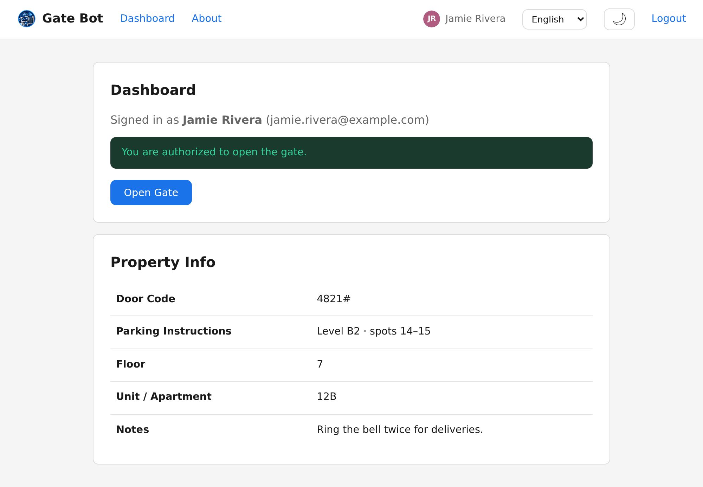
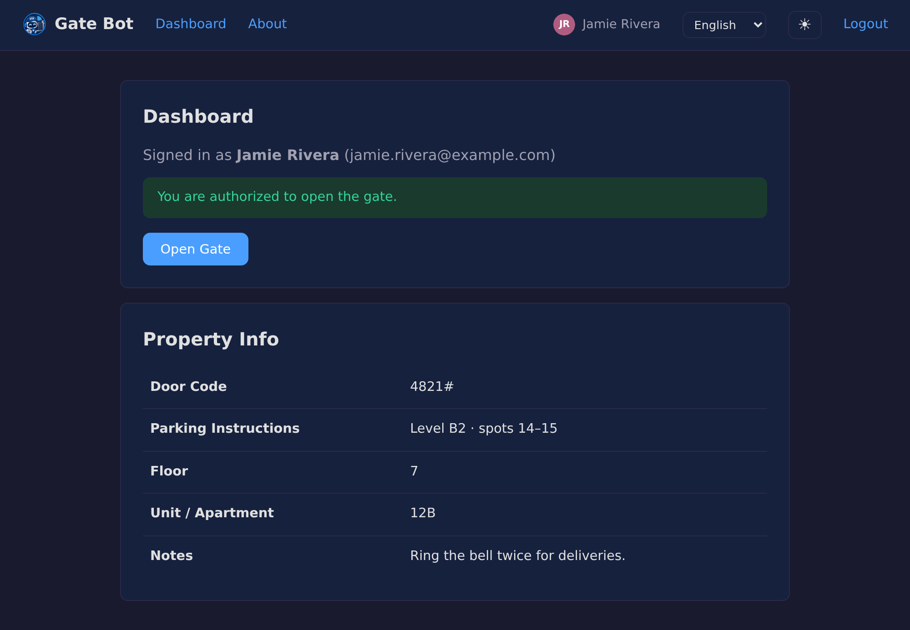
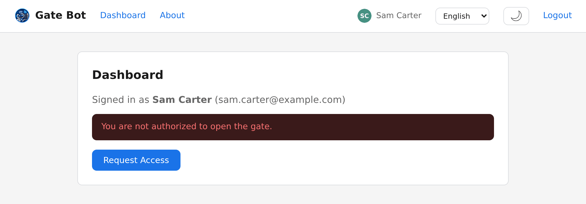
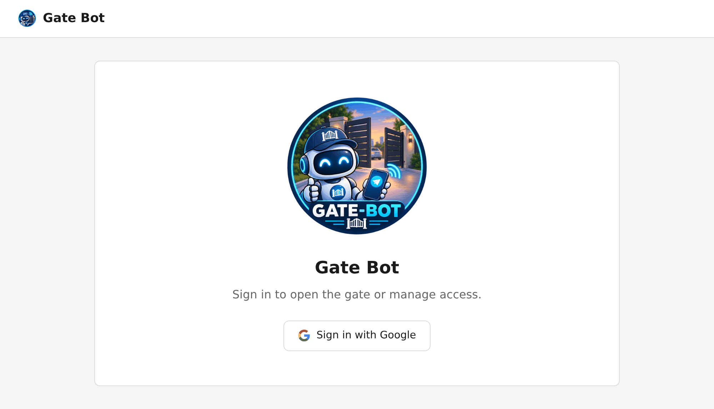
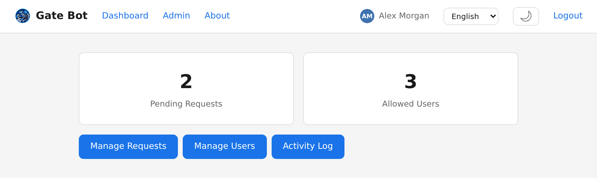
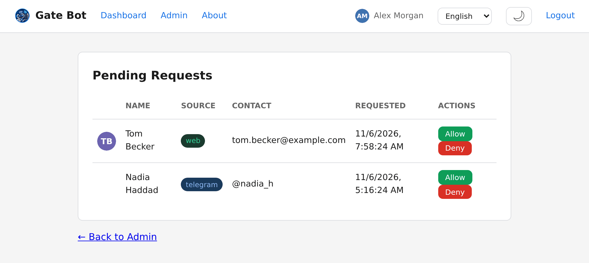
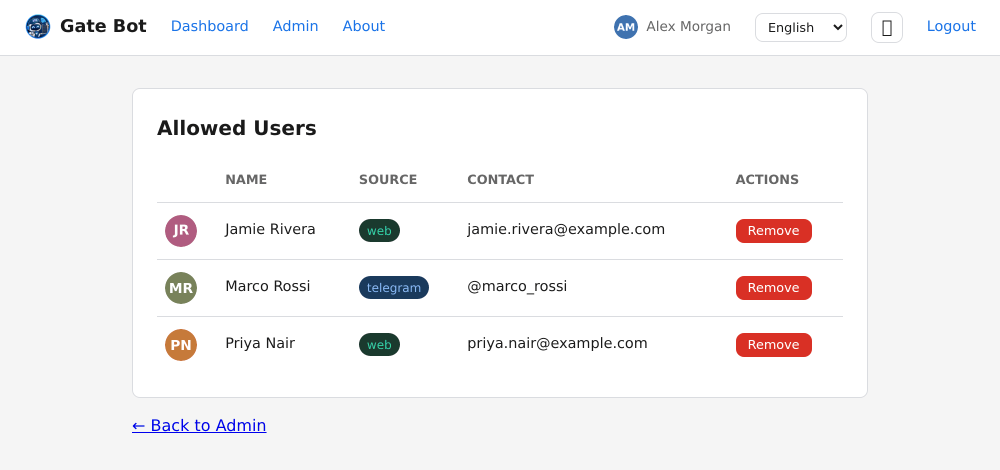
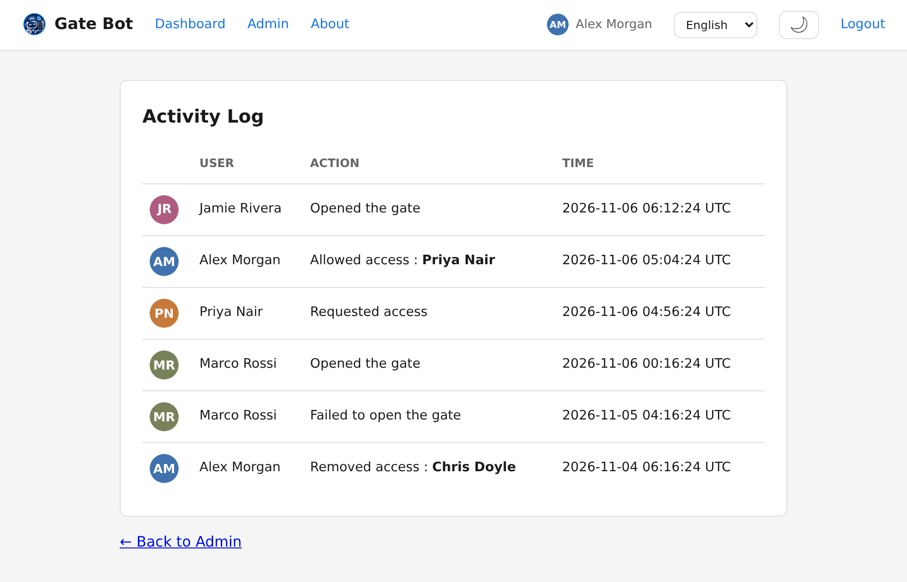

<p align="center">
  
</p>

<h1 align="center">Gate Bot</h1>

<p align="center">
  <strong>Open your gate from Telegram or the browser — with access requests, approvals, an activity log and Home Assistant integration.</strong>
</p>

<p align="center">
  <a href="LICENSE"></a>
  <a href="https://hub.docker.com/r/noamokman/gate-bot"></a>
  <a href="https://hub.docker.com/r/noamokman/gate-bot"></a>
  <a href="https://github.com/noamokman/gate-bot/actions/workflows/lint.yml"></a>
</p>

<p align="center">
  
</p>

Gate Bot lets authorized people open a gate from a Telegram bot or a web dashboard, and gives admins one place to approve access requests, manage users and review everything that happened. It talks to your gate over HTTP or MQTT, so it drops straight into Home Assistant.

Telegram and the web UI are independent modules — run either one or both:

- **Telegram only** — set `BOT_TOKEN` and leave the web UI off.
- **Web only** — set `WEB_ENABLED=true` without a `BOT_TOKEN`. Admins get notified over MQTT / Home Assistant and approve requests from the web admin panel.
- **Both** — the full setup: Telegram notifications plus the web dashboard, with both sources visible in one admin panel.

## Features

- 🔐 **Authorization** — only approved users can open the gate. Access is tracked per source, so someone can be allowed on Telegram, on the web, or both.
- 🙋 **Access requests** — anyone can ask for access. Admins receive the request on Telegram with inline **Allow** / **Deny** buttons, or in the web admin panel — always with the requester's name and photo.
- 🔑 **Open the gate** — `/open` on Telegram, or the **Open Gate** button on the dashboard.
- 📋 **Property info** — door code, parking instructions, floor, unit and notes, shown only to authorized users.
- 🧾 **Activity log** — every gate opening, failed opening, access request, approval, denial and removal, with who did it, to whom, and when. Admins only.
- 🕓 **Rolling history** — the log keeps the most recent entries and drops the oldest, capped by `ACTIVITY_LOG_LIMIT`.
- 🔗 **Telegram and web linked** — the bot links to the web UI, and the site links back to the bot.
- 🖥️ **Web UI** — Google sign-in, light/dark theme that follows the system, and English, Russian and Hebrew localizations.
- 🧩 **Two transports** — call an HTTP endpoint, or publish over MQTT with automatic Home Assistant discovery.
- 🐳 **Ready to deploy** — a published Docker image with a built-in health check, and a JSON file as the only state (easy to back up).

## Screenshots

| User dashboard | Dark theme |
| --- | --- |
|  |  |

| Requesting access | Sign in |
| --- | --- |
|  |  |

| Admin panel | Pending requests |
| --- | --- |
|  |  |

| Allowed users | Activity log |
| --- | --- |
|  |  |

_Screenshots show mock data._

## How it works

```
Telegram bot ─┐
              ├─► event bus ─► Telegram notifications
Web UI ───────┘             ├─► MQTT / Home Assistant
                            └─► activity log
```

Every action raises a domain event (`src/services/events.ts`). The Telegram, MQTT and activity-log listeners subscribe to that bus, which keeps the sources independent: a gate opening triggered from the web notifies the Telegram admins and lands in the activity log without either side knowing about the other.

- **Telegram bot** (`src/bot/`) — Telegraf, commands plus inline Allow/Deny buttons.
- **Web UI** (`src/web/`) — Express + EJS server-rendered pages, Google OAuth (or password login for local testing), file-backed sessions.
- **Gate transports** (`src/services/http.ts`, `src/services/mqtt.ts`) — HTTP POST or MQTT with HA discovery.
- **State** — a single lowdb JSON file at `DB_PATH` (users, pending requests, activity log).

## Quick start

### Docker Compose

```yml
services:
  gate-bot:
    image: noamokman/gate-bot
    container_name: gate-bot
    environment:
      DB_PATH: /config/db.json
      # Telegram bot (omit BOT_TOKEN for web-only mode)
      BOT_TOKEN: ${BOT_TOKEN}
      ADMIN_USER_IDS: ${ADMIN_USER_IDS}
      # Gate transport — HTTP mode
      GATE_URL: ${GATE_URL}
      # Gate transport — MQTT mode
      MQTT_URL: ${MQTT_URL}
      MQTT_COMMAND_TOPIC: ${MQTT_COMMAND_TOPIC}
      MQTT_DISCOVERY_TOPIC: ${MQTT_DISCOVERY_TOPIC}
      # Property info
      DOOR_CODE: ${DOOR_CODE}
      PARKING_INFO: ${PARKING_INFO}
      FLOOR: ${FLOOR}
      UNIT: ${UNIT}
      PROPERTY_NOTES: ${PROPERTY_NOTES}
      # Web UI (set WEB_ENABLED=true to enable)
      WEB_ENABLED: ${WEB_ENABLED}
      WEB_BASE_URL: ${WEB_BASE_URL}
      WEB_SESSION_SECRET: ${WEB_SESSION_SECRET}
      GOOGLE_CLIENT_ID: ${GOOGLE_CLIENT_ID}
      GOOGLE_CLIENT_SECRET: ${GOOGLE_CLIENT_SECRET}
      GOOGLE_ADMIN_EMAILS: ${GOOGLE_ADMIN_EMAILS}
    volumes:
      - ./config/:/config
    restart: unless-stopped
```

Point `./config/` at any writable host directory — that's where the database and web sessions live.

### Run locally

```sh
git clone https://github.com/noamokman/gate-bot.git
cd gate-bot
yarn install
```

Create a `.env` file in the repository root with the variables you need (see [Configuration](#configuration)), then:

```sh
yarn start        # nodemon + tsx, reloads on change
```

or build and run the compiled output:

```sh
yarn build && node dist/index.js
```

## Configuration

Everything is configured through environment variables. `DB_PATH` is the only one that is always required; the rest depend on the modules you enable.

| Variable | Required | Default | Description |
| --- | --- | --- | --- |
| `DB_PATH` | yes | — | Path to the JSON database file (e.g. `/config/db.json`). |
| `ACTIVITY_LOG_LIMIT` | no | `100` | Maximum number of activity log entries to keep. The oldest are dropped first. |
| **Telegram bot** | | | |
| `BOT_TOKEN` | no | — | Telegram bot token. Omit it to run without the Telegram bot. |
| `ADMIN_USER_IDS` | no | — | Comma-separated Telegram user IDs of the admins. |
| **Gate transport** | | | |
| `GATE_URL` | no | — | HTTP endpoint called when an authorized user opens the gate. |
| `MQTT_URL` | no | — | MQTT broker URL. |
| `MQTT_COMMAND_TOPIC` | no | — | MQTT topic used to publish gate events. |
| `MQTT_DISCOVERY_TOPIC` | no | — | MQTT topic used for Home Assistant discovery. |
| **Property info** | | | |
| `DOOR_CODE` | no | — | Door code. |
| `PARKING_INFO` | no | — | Parking instructions. |
| `FLOOR` | no | — | Floor number. |
| `UNIT` | no | — | Unit / apartment number. |
| `PROPERTY_NOTES` | no | — | Any additional property notes. |
| **Web UI** (all marked ones are required when `WEB_ENABLED=true`) | | | |
| `WEB_ENABLED` | no | `false` | Enables the web server. |
| `WEB_BASE_URL` | yes* | — | Public URL of the web server (e.g. `https://gate.example.com`). Also used for the Google OAuth redirect. |
| `WEB_SESSION_SECRET` | yes* | — | Random string used to sign session cookies. |
| `GOOGLE_CLIENT_ID` | yes* | — | Google OAuth 2.0 client ID. |
| `GOOGLE_CLIENT_SECRET` | yes* | — | Google OAuth 2.0 client secret. |
| `GOOGLE_ADMIN_EMAILS` | no | — | Comma-separated emails that get admin access on the web UI. |
| `WEB_PORT` | no | `3000` | Port the web server listens on. |
| `WEB_SESSION_PATH` | no | `<DB_PATH dir>/sessions` | Directory for session files (30-day TTL). |
| `BASIC_AUTH_USERS` | no | — | Password login for local testing: `user,pass,isAdmin` tuples separated by `;` (e.g. `admin,secret,true;guest,pass,false`). **Not recommended for production.** |
| `HEALTHCHECK_PATH` | no | `/healthz` | Path the container health check probes. |
| `HEALTHCHECK_HOST` | no | `127.0.0.1` | Host the health check connects to. |
| `HEALTHCHECK_TIMEOUT_MS` | no | `2000` | Health check timeout in milliseconds. |
| **Other** | | | |
| `BUILD_VERSION` | no | `0.0.0` | Reported by `/version`, the health endpoint and the About page. Set automatically by the Docker build. |

\* Required only when `WEB_ENABLED=true`.

## Usage

### Telegram commands

| Command | Description |
| --- | --- |
| `/start` | Start the bot |
| `/help` | How to use the bot |
| `/open` | Open the gate |
| `/check_authorization` | Check whether you are allowed to open the gate |
| `/request_access` | Request access to open the gate |
| `/info` | View property info (door code, parking, floor, unit, notes) |
| `/activity` | View the activity log (admins only) |
| `/version` | Show the current version |
| `/web` | Link to the web UI (only when the web UI is enabled) |

### Web UI

The web server starts when `WEB_ENABLED=true`. When the Telegram bot is also enabled, its handle is fetched from the Telegram API and shown on the login page and in the navigation; the bot links back with `/web`.

| Page | URL | Access |
| --- | --- | --- |
| Login / Dashboard | `/` | Public for login, authenticated users for the dashboard |
| Open gate & property info | `/` | Authorized users |
| About | `/about` | Public |
| Admin panel | `/admin` | Admins |
| Pending requests | `/admin/pending` | Admins |
| Allowed users | `/admin/users` | Admins |
| Activity log | `/admin/activity` | Admins |

**Requesting access:** sign in with Google, click **Request Access**, and wait for an admin to approve you — on Telegram or in the web admin panel. The request appears in both. Web access requests are only supported for Google accounts.

**Admins** can approve or deny requests with one click, manage the list of allowed users, and review the activity log. On the web, admin rights come from `GOOGLE_ADMIN_EMAILS`; on Telegram, from `ADMIN_USER_IDS`.

## Home Assistant integration

With MQTT configured, the bot publishes a retained discovery message so Home Assistant picks it up as an event entity — no manual configuration needed.

Discovery topic (example): `homeassistant/event/gate_bot_event/config`

```json
{
  "name": "Gate Bot Event",
  "unique_id": "gate_bot_event",
  "event_types": [
    "gate_bot_triggered",
    "gate_open_failed",
    "access_request_created",
    "access_request_allowed",
    "access_request_denied",
    "user_removed"
  ],
  "state_topic": "home/gate_bot/event",
  "json_attributes_topic": "home/gate_bot/event",
  "device": {
    "identifiers": ["gate_bot"],
    "name": "Gate Bot",
    "manufacturer": "Custom",
    "model": "Gate Bot"
  }
}
```

Events are published to `MQTT_COMMAND_TOPIC`, each with an `event_type`, the `source` (`gate_bot`) and an event-specific payload.

**Gate opened** — an authorized user opened the gate:

```json
{
  "event_type": "gate_bot_triggered",
  "source": "gate_bot",
  "action": "open_gate",
  "userInfo": {
    "userId": "123456789",
    "username": "example_user",
    "firstName": "John",
    "lastName": "Doe",
    "sourceType": "telegram"
  }
}
```

`userInfo.sourceType` is `telegram` or `web`, so automations can tell where the request came from.

**Gate open failed** — opening failed; the payload carries an `error` field.

**Access request created** — someone requested access:

```json
{
  "event_type": "access_request_created",
  "source": "gate_bot",
  "request": {
    "id": "telegram:123456789",
    "sourceType": "telegram",
    "sourceUserId": "123456789",
    "name": "John Doe",
    "username": "example_user",
    "requestedAt": "2026-08-15T12:00:00.000Z"
  },
  "url": "https://gate.example.com/admin/pending"
}
```

The `url` field is included when the web UI is enabled, so a notification can link straight to the page where an admin approves or denies the request — handy in web-only mode without a Telegram bot.

**Access request allowed / denied** — an admin approved or denied a request; includes the `request` and the resolving `admin` (name and email for web admins, user ID for Telegram admins).

**User removed** — an admin removed a user's access; includes `userId`, `sourceType` and the resolving `admin`.

## Development

```sh
yarn install
yarn start        # dev server with reload
yarn lint:base    # eslint (the CI gate)
yarn build        # tsc -> dist/, plus views/locales/assets
```

Requirements: Node.js 24+ and yarn.

**Project layout**

```
src/
  actions/       inline button handlers (allow / deny)
  bot/           Telegram bot wiring
  commands/      Telegram commands
  framework/     environment/config
  services/      db, events, gate transports, activity log
  web/           Express app, routes, controllers, views, locales
  index.ts       starts the web server, Telegram bot and MQTT
```

**Adding a listener** — subscribe to the event bus instead of calling Telegram or MQTT directly:

```ts
onEvent(async (event) => {
  if (event.type === 'gate_opened') {
    // ...
  }
});
```

## License

[MIT](LICENSE)
